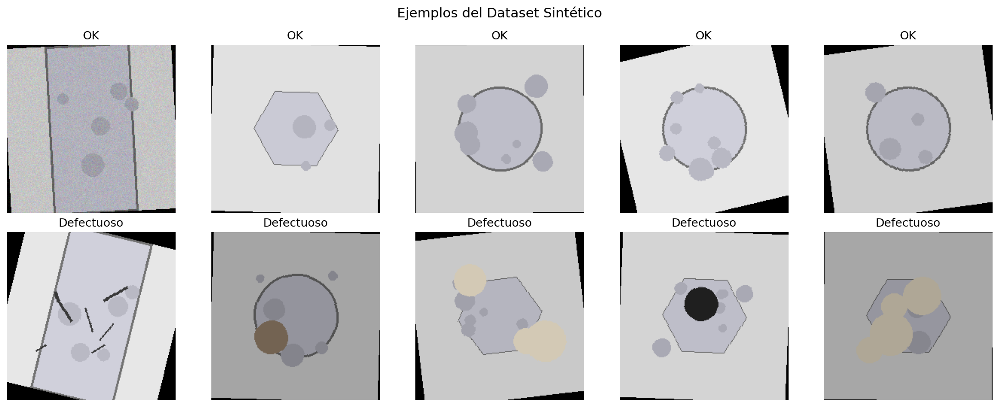
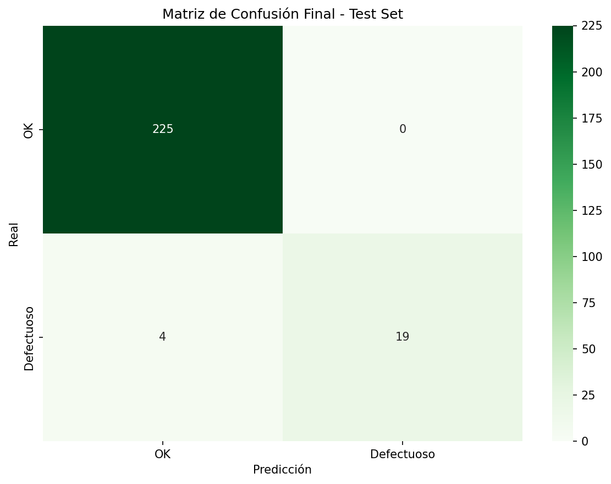
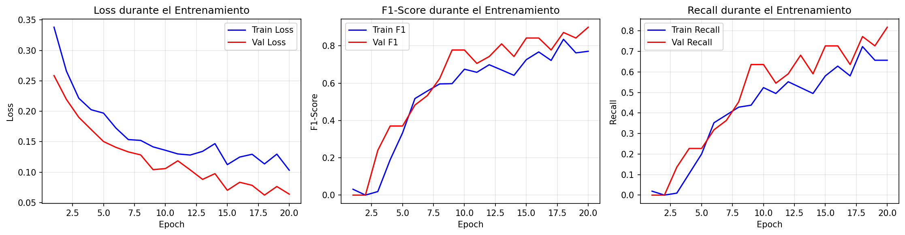

# Detección de defectos industriales

Proyecto académico de clasificación binaria de imágenes industriales con **ResNet-50 y transfer learning**. El notebook genera un dataset sintético, entrena el modelo y evalúa la detección de piezas defectuosas.

> **Alcance:** las imágenes son sintéticas y el conjunto de prueba es pequeño. Estos resultados sirven como demostración del flujo de trabajo, no como validación para una línea de producción real.

## Resultados

Evaluación final reportada en el conjunto de prueba (248 imágenes; 23 defectuosas):

| Métrica para la clase defectuosa | Resultado |
|---|---:|
| F1 | 0,9048 |
| Precisión | 1,0000 |
| Recall | 0,8261 |
| Defectos no detectados | 4 de 23 (17,4 %) |

El recall y los falsos negativos son especialmente relevantes en inspección de calidad: el modelo todavía deja pasar algunas piezas defectuosas. Las métricas deben interpretarse considerando el tamaño y el carácter sintético del dataset.

## Ejemplos y evaluación







## Estructura

- `notebooks/industrial_defect_classification.ipynb`: generación de datos, entrenamiento, evaluación y predicción.
- `images/`: ejemplos del dataset y gráficos generados por el notebook.
- `requirements.txt`: dependencias de Python.
- `course_materials/`: informes, archivo original y pesos del modelo; se conservan localmente y están excluidos de Git.

## Ejecución

Se recomienda Python 3.10 o posterior. Desde la raíz del proyecto:

```bash
python -m venv .venv
source .venv/bin/activate  # Windows: .venv\Scripts\activate
python -m pip install -r requirements.txt
jupyter notebook notebooks/industrial_defect_classification.ipynb
```

El notebook genera `synthetic_industrial_dataset/` al ejecutarse. ResNet-50 con pesos preentrenados puede descargar los pesos oficiales de Torchvision durante la primera ejecución; el acceso a Internet y suficiente memoria GPU/CPU pueden ser necesarios.

## Licencia

El código y los materiales originales de este repositorio se distribuyen bajo la licencia [MIT](LICENSE), en la medida en que sus derechos pertenezcan al titular indicado en el archivo. Puedes usarlos, copiarlos, modificarlos y redistribuirlos, incluso con fines comerciales, siempre que conserves el aviso de copyright y el texto de la licencia. Se proporcionan “tal cual”, sin garantía.
